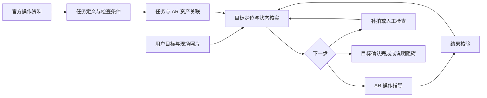

# Manual2AR

将设备操作资料与现场状态结合，为用户提供任务定位、安装核验和 AR 操作指导。

Manual2AR 是基于 Unity 和 Python 的研究原型。系统以官方操作资料为依据，结合用户的自然语言目标与现场照片，确定任务范围、核实已有进度，并通过现有 AR 资产展示细粒度操作。当前主要演示设备为 Bambu Lab A1 mini，核心示例为 U7 料盘支架安装。

## 功能概览

- **部件认知**：结合设备资料与图像，提供部件信息和识别结果。
- **操作指导**：保留开箱、首次打印、进料、退料等教程，支持图文浏览和 U7 问答拍照指导。
- **现场核验**：将视觉观察与人工检查结合，区分已满足、未满足和无法确定的条件。
- **AR 展示**：根据当前操作调用已有动画资产；核验反馈更新后续指导。
- **研究工具**：提供资料编译、任务契约校验、候选人工审核、缓存回放及对照评价工具。

## 工作流程

离线阶段将操作资料整理为具有来源引用、任务层级、依赖关系与检查条件的任务定义，并关联 AR 资产。在线阶段根据用户目标定位任务，再通过照片和必要交互核实现场状态，选择操作、补拍、人工检查或结束。



当前 U7 Demo 使用已审核的任务定义，不在每次提问时重新编译资料。自动资料编译管线独立保留，用于研究与对照。

## U7 演示

U7 包含两个官方细粒度操作：**安装底座 → 滑入支架**。

支持的示例目标包括：

- “安装料盘支架”
- “安装支架底座”
- “滑入料盘支架”
- “安装料盘底座及滑入料盘支架”

目标范围不明确时，系统展示官方任务候选。现场照片评估后，界面显示已支持的状态、待核实内容及当前动作；人工检查集中在同一窗口确认。操作结束后重新拍照核验，播放动画本身不改变完成状态。

提供两种模式：

| 模式 | 输入与用途 |
| --- | --- |
| 历史照片演示（默认） | 使用历史照片和明确标注的预设观察，稳定展示完整交互流程，不调用视觉模型 |
| 实时拍摄 | 手动启动相机、拍摄现场并调用真实视觉模型，保留无法确认和调用失败的情况 |

两种模式的 Demo 记录均不纳入正式研究评价。完整操作说明见 [U7 Demo](baseline/U7_DEMO.md)。

## 环境要求

| 组件 | 环境 |
| --- | --- |
| 后端 | Python 3.12，Linux 或 WSL |
| 前端 | Unity 2022.3.34f1，Windows 客户端 |
| 真实视觉 | 兼容现有接口的视觉语言模型服务及 API 凭据 |
| 可选推理服务 | 用于相关识别、分割与跟踪模块的 GPU 服务 |

默认 U7 历史照片演示不需要模型密钥或 GPU，但需要准备对应照片与预设清单。

## 安装与运行

### 1. 获取源码并安装依赖

```bash
git clone --branch Dev https://github.com/lixinyiCQU/Manual2AR.git
cd Manual2AR
bash run.sh setup
```

安装脚本创建 Python 虚拟环境，安装锁定依赖和本地包，并安装 Playwright Chromium。首次运行会从 `configs/app.example.json` 生成本机配置 `configs/app.local.json`。

### 2. 配置资源与服务

在 `configs/app.local.json` 中配置：

- `paths`：离线资料、运行数据、缓存和构建输出位置。
- `backend`：后端监听地址、端口及客户端访问地址。
- `vlm`：实时视觉使用的模型服务地址和 API 密钥。
- `gpu.connection_file`：可选 GPU 服务连接配置。

本机配置与连接凭据不纳入 Git。配置模板的默认后端端口为 `8010`，以实际本机配置为准。

仓库包含源码、任务定义、配置模板及受版本控制的资源。离线 Wiki 归档、完整实验数据、演示照片、部分外部资产和预编译 Windows 程序需另行准备；仅克隆源码不等于已具备完整运行数据。资源路径见 [配置模板](configs/app.example.json)，U7 演示素材准备见 [演示说明](baseline/U7_DEMO.md)。

### 3. 校验资源并启动后端

```bash
bash run.sh resources
bash run.sh sync
bash run.sh start
```

`resources` 校验资源完整性，`sync` 为 Unity 生成配置、教程和展示资源。后端启动后，可通过配置地址下的 `/health` 检查服务状态。

### 4. 启动前端

使用 Unity 打开 `apps/unity/Manual2AR/`，从 `Assets/Manual2AR/Scenes/Welcome.unity` 场景运行；也可使用另行提供的 Windows 构建。客户端后端地址应与本机配置一致。

## 项目结构

| 路径 | 内容 |
| --- | --- |
| `baseline/` | 任务契约、目标匹配、状态与调度、视觉核验、资料编译及评价 |
| `apps/backend/` | Python 应用、业务 API 与模型适配 |
| `apps/unity/Manual2AR/` | Unity 场景、交互界面、相机与 AR 展示 |
| `apps/inference/` | 可选 GPU 推理服务 |
| `packages/` | 共享数据契约、感知与几何组件 |
| `resources/` | 教材、任务配置、提示词、样例及展示资产 |
| `tests/` | 后端与 Unity 验证 |
| `tools/` | 资源管理、构建、部署与实验工具 |
| `configs/`、`deploy/` | 配置模板与部署入口 |
| `docs/` | 架构、使用和开发文档 |

## 测试与构建

后端及独立核心测试：

```bash
PYTEST_DISABLE_PLUGIN_AUTOLOAD=1 .venv/bin/python -B -m pytest \
  tests baseline/tests -q -p no:cacheprovider
```

导出 Unity 工程：

```bash
bash run.sh package
```

`package` 不编译 Windows EXE。Windows 构建使用 `tools.build.validate_desktop --build` 完成 Unity 验证，再通过 `tools.build.spatial_delivery` 校验构建指纹并导出交付文件。构建需要 Windows Unity 编辑器及独立的临时验证工程。

## 当前范围

当前经过审核的完整任务与 AR 演示主要覆盖 U7，不代表已实现跨设备的通用任务编译与视觉验收。视觉模型可能误认部件或无法看清细节，未知条件不会直接视为未安装，人工确认也不能替代必需的视觉证据。

U7 Demo 的 AR 动画是照片平面上的操作示意，可手动调整位置，不代表自动三维配准或实体安装精度已通过验证。系统面向本地、单用户研究与演示，尚未完成面向公网多用户服务的部署验证。

## 文档

- [系统架构](docs/ARCHITECTURE.md)
- [使用与空间标定](docs/OPERATIONS.md)
- [基线与任务定义](baseline/README.md)
- [目标定位与现场指导](baseline/GOAL_FLOW.md)
- [条件计划与缓存试验](baseline/ONLINE_PLANNING.md)
- [视觉核验](baseline/VISION.md)
- [自动资料编译](baseline/COMPILATION.md)
- [评价方案](baseline/EVALUATION.md)
- [Agent 开发入口](README_AGENT.md)
