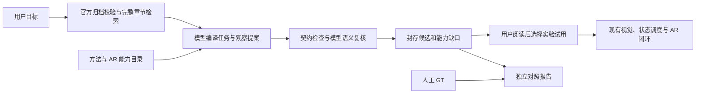

# 自动官方资料编译替换 GT 输入

当前主入口：模块二任务列表 → **从官方资料生成 AR 任务**。输入目标，阅读生成的操作、条件和出处，选择“已阅读候选，进入 AR 试用”。原入口改名为 **U7 GT 对照**，供独立对照。

自动路径从官方原始归档生成任务、视觉协议和 AR 绑定；不读取 `ground_truth/` 中的任务、人工映射、核验协议或审核答案。`gt.py` 中的通用契约类继续复用。编译完成封存之后，独立的 `compare-gt` 才读取 GT，且不会修改候选。



## 输入与来源

[资料适配器](src/manual2ar_baseline/sources.py) 使用当前官方离线 Wiki 归档。公开的 `resources/sources/bambu_wiki/manifest.json` 固定 archive SHA；继续校验原页面、DOM 和图片的路径、大小与 SHA。从原 DOM 重新解析文字、标题、选择器和图片关系，核对缓存 extraction；引用 ID 从原 URL、DOM SHA、序号重新派生。

检索收束到完整父章节，保留底座、支架及适用范围。当前自动检索选中官方 standalone 开箱页的“第 7 步：安装料盘支架”，并未强行使用 GT 对应的 combo 页或 GT 图片。来源包只含 `official`，仍标记 `source_selection=unconfirmed`，不会冒称用户确认过自动选材。

用户原话保存在请求记录中。编译提示只接收检索得出的操作目标，不接收“我已完成……”声明。当前入口明确是安装场景，因此“希望完成某部件”可解释为安装目标，并记录该解释；明确的安装、拆卸目标仍分别处理。含否定或复杂约束的目标保守拒绝，请用户明确操作，不能把“不希望安装”反转成安装。

## 编译与方法

[编译器](src/manual2ar_baseline/compiler.py) 生成 `TaskDefinition`、逐条件方法、观察查询／规则和已有资产绑定。要求引用必须是原文连续文本；还从原文提取可选择的引用片段供模型复制，避免把改写句误当引文。

[能力目录](capabilities/v1.json) 声明四种视觉观察、人工方法和现有 U7 AR 操作范围。它不提供 GT 节点、期望数量、已完成状态或固定 ROI。

程序检查包括：

- 官方引用、对象／条件／节点引用、无环依赖，以及完整任务仍位于目标依赖闭包中。
- 数量与螺丝物理位置数一致；规格仅作选材，方向和实际紧固不能作为视觉完成结果。
- 紧固件安装有独立的机械紧固人工条件；这是明确的方法策略，派生条件标为 `normalization_proposal`。
- 每个条件都有方法，每个视觉条件恰有查询和规则；只接受引擎已有枚举。
- 固定件检查按所属操作和唯一安装关系派生整图→ROI 观察；不能唯一关联就报告能力缺口。对象 ID 可由模型生成，螺丝与底座不必共用 ID。
- AR 的节点覆盖、已登记动作、资产指纹和现有作用点容量。不支持就保留候选并阻止执行，不删节点迁就资产。

每个编译／语义复核阶段最多允许一次显式格式修复，保留原始回复及拒绝记录。没有 HTTP 自动重试、静默换模型或回退 GT。语义复核由同一配置模型另轮完成，不代表独立人工语义评价。

状态为 `failed`、`blocked` 或 `experimental_ready`。后者表示可以审阅试用，不是人工批准或视觉标准已验证。任务语义问题、未解决要求及能力缺口均可阻止进入执行。

## 接入同一闭环

[宿主入口](../apps/backend/src/manual2ar/modules/guidance/official_compiler.py) 的 API 为 `/api/guidance/compiled/jobs`。生成是后台任务；候选预览包括出处和限制。试用请求绑定候选 manifest SHA，并记录为实验试用选择，不伪造 `approved_for_state_validation`。

每个候选注册独立的 `/api/guidance/compiled/jobs/{id}/spatial`，通过 [AR 适配器](../apps/backend/src/manual2ar/modules/guidance/baseline_spatial.py) 装载生成的任务、协议、绑定及官方参考图。运行模式为 `experimental_compiled_photo_analysis`；原 GT 对照的模式及审核状态保留。

所有条件初始为 unknown。照片、裁剪、人工确认、遮挡沿用和下一步继续由已有基线处理。人工确认绑定当前任务 SHA、会话 ID、epoch、revision 和条件；跨任务、旧窗口、跳步均拒绝。宿主固定激活时的整个 manifest SHA，在核验调用前和回写前复核产物／来源；同任务的新协议也不能悄悄替换当前运行定义。

不跨服务重启自动恢复编译任务，运行中的任务不会热替换成另一版本。候选、回放、照片和确认记录保留在 `runtime_dir/official-compilation/` 与 `runtime_dir/baseline-ar/compiled-<id>/`。没有公开上传任意 Sources／候选文件的入口。

## 命令行

从仓库根目录运行，输出目录必须不存在并放在仓库外：

```bash
PYTHONPATH=baseline/src .venv/bin/python -B -m manual2ar_baseline compile-official \
  --archive /home/lixin/projects/Manual2AR-Data/sources/bambu-wiki/runs/20261024T145623Z_e2655a/archive.json \
  --manifest resources/sources/bambu_wiki/manifest.json \
  --intent '我希望安装料盘支架' \
  --config configs/app.local.json --model qwen3.8-flash \
  --output /tmp/u7-official-compilation-new

PYTHONPATH=baseline/src .venv/bin/python -B -m manual2ar_baseline compare-gt \
  --compiled /tmp/u7-official-compilation-new \
  --gt baseline/ground_truth/u7/v1/state-validation \
  --output /tmp/u7-compiled-gt-comparison-new
```

这里沿用既有配置模型。凭据不写入产物；真实编译可能产生调用费用。原始提示、Schema、回复、实际用量、引用片段、来源与实现指纹均封存。独立比较只报告结构及同源词面覆盖；不同官方页面不计算词面覆盖率，没有人工语义标签就不报告准确率。

## 本次结果与范围

真实模型曾生成两个操作节点、六个条件：底座贴靠、两颗螺丝联合可见、机械紧固确认、底座方向确认、支架连接和支架方向确认。它没有复制 GT 的两个额外外观检查条件；GT 还包含手工核验策略，六与八的差异需单独评审，不能直接算为错误或正确。

第二种输入的真实模型回复已完成任务和语义复核，但被过严的 ROI 归属检查阻止。修正通用归属规则后，使用原始回复逐字回放，未改任务或条件，得到带 ROI 的可加载候选；这次回放没有再次调用模型。该候选已跑完受控 AR API 闭环。早期引用、枚举、格式失败全部保留，未将失败包装成成功，也没有据此计算成功率。

三种表达已验证检索到相同官方来源：“已完成底座，现在安装支架”“希望安装支架”“希望完成支架”。最新归档和人工审阅入口见根目录 Agent 快照。

Unity 已编译并验证候选预览→生成任务 AR→返回预览；使用受控资料／模型，不是现场推理。相关 Python 测试还覆盖拒绝错误引述、三颗固定件、无 GT 读取、跨任务确认、模型调用期间篡改及同任务换协议。没有重新构建 Windows EXE，实际使用需重启后端并编译当前前端。

当前实际 AR 资产仍限 U7。观察器只支持已列方法；检索父章节启发式主要验证阿拉伯编号教程，中文数量支持一至十及阿拉伯数字，复杂中文数量保守拒绝。模型会发生格式、引用或语义错误，尚无留出任务／新设备的独立语义与实物评价；本阶段不是通用性已证明的结果。
