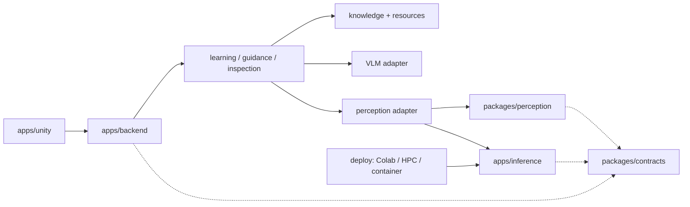

# 依赖与运行边界

Unity 调用统一业务后端，业务后端按任务组织语义判断与用户交互；CPU 算法在本机执行，GPU 推理通过 HTTP 调用。Colab、HPC 和容器是同一推理服务的部署方式。

- `manual2ar.application.server.create_app` 是应用组合入口，注入三个独立配置并管理子应用生命周期。业务模块之间禁止相互导入。
- 三个模块保持 `/api/learning`、`/api/guidance`、`/api/inspection`；`/api/app` 提供目录、公开设置和契约。统一错误携带请求 ID，并保留现有客户端的 `detail`。
- `manual2ar_contracts` 只定义共享身份、几何及 GPU 协议；`manual2ar_perception` 仅依赖这些契约和 CPU 图像库，不导入教学业务或部署代码。
- `manual2ar_inference` 只负责首帧分割、多对象会话记忆及后续帧跟踪，不导入业务后端、Colab 或 HPC。`--config`、`--work-dir` 显式传入私有设置和数据目录。
- `deploy/common` 准备环境、校验权重、导出连接；`deploy/colab` 额外管理解释器与 Drive 缓存。Notebook 内嵌由构建器导出的源码包，清单记录每个文件的规范源码位置和 SHA256。
- GPU 协议仍为 `manual2ar-learning-cutie-v2`，保持旧 GPU 服务兼容。模型位置、Cutie 记忆、图像哈希、帧次序及 GPU 错误语义不随目录迁移改变。

# 数据与资源

`resources/catalog.json` 提供逻辑资源名称。业务模块通过注入的 `resources_dir` 解析路径，任务目录必须在资源根目录内；任务内的图片、Prompt 和证据继续按原有哈希校验。

`devices/<设备>/<版本>` 保存部件目录和原文知识卡选取规则；`tasks/<设备>/<任务>/<版本>` 保存 procedure、观察点、专用 Prompt、参考图、动画和引用。`modules` 保存入口目录。原始 Wiki 响应、对象库及抓取证据位于项目外，`sources` 仅保留其版本与校验清单。

`ProcedureDocument`、`ProcedureState`、`ObservationNode` 位于模块二的 `models.py`；它们属于操作指导的业务契约。共享位置与掩码契约位于公共 contracts 包。当前不改变 JSON 字段、任务 ID 或版本，以免迁移影响既有结果。

配置只由 application 层组合：公共模板和本地配置在 `configs`；模块内默认值是 Python 包资源。公开导出使用白名单，API Key、令牌和主机文件路径不会进入 Unity。字体由 `resources/shared` 保存，sync 复制进 Unity 并保留 `.meta` GUID。公开配置、图片导出及字体副本被 Git 忽略，可由 sync 重建。

# 三个模块的语义

- 部件认知：用户界面仅使用摄像头，知识阅读可独立使用。VLM 定位后分割并持续跟踪；静态原图输入仅留在后端调试 API 与实验脚本中。
- 操作指导：开箱支持外挂料盘和 AMS lite 两种教材，自由浏览、人工标记与视觉建议分别记录。首次打印和外挂料盘进退料保持原任务约束。
- 打印检查：保留打印板异物/残料、分阶段框与掩码、目标移出板面、干净复检跳过不必要分割、默认打印头遮挡的人工确认和任务占位。

坐标始终相对于已旋转、镜像校正的提交图像，使用 0..1000；帧编号和源图像哈希用于防止旧结果覆盖当前画面。教程浏览完成、识别到部件、已知异物移出板面与整板复检通过具有不同含义。

Unity `Scripts/Common` 管理主题、字体、圆角、图标、工作区模板、按钮组、相机工具栏、正文、弹窗和跨场景导航（见 [UI 契约](UI_CONTRACT.md)）；各业务模块独立管理相机与异步状态。离开模块关闭会话，迟到响应被丢弃。

# 后续扩展

新增同类任务时，在对应设备的 tasks 下创建版本化任务包，登记模块目录；TaskRegistry 会校验状态链、观察点、Prompt 与图片。新的非线性工作流仍需扩展执行器，目录化不会自动赋予执行能力。

新增设备时创建独立 devices 和 tasks 目录，配置相应的知识、定位 Prompt、参数和模块目录。当前选择的设备仍是 A1 mini，UI 和部分请求数量限制尚未泛化成任意设备平台。

新增离线来源时保留原文、来源 URL、抓取身份和哈希，再编译到设备/任务资源；新增解析格式放在 `manual2ar.knowledge`。不要把大量原始档案复制进业务源码。

更换 GPU 运行位置时保留推理服务和协议，仅更换部署入口及连接 JSON。新增算法时在 inference/engines 或 CPU perception 包实现，再经后端适配器接入，避免教学模块直接依赖 GPU 库。

# Colab 本地编排

`tools/deployment/colab.py` 在 WSL 中通过固定版本官方 CLI 管理本项目专用会话；`deploy/colab/worker.py` 在云端监督环境准备、GPU 进程和临时连接。VS Code 工作区任务复用此入口，三个业务模块只读取原来的连接 JSON。部署源码按清单和 SHA 校验，部署设置白名单过滤，带私有令牌的文件通过文件接口传输后做健康校验与原子安装。服务进程和云端运行时释放是两个独立动作；不会操作其他用户笔记本的运行时。详见 `COLAB_VSCODE.md`。

# 资料库与可复用教学首页

`application.services.ServiceRegistry` 读取 `resources/services/catalog.json`。`/api/app/services` 提供公开目录，`/api/app/services/{id}` 提供单个服务的教学页元数据；服务只能引用已支持的模块场景。元数据不包含凭据、工作站路径或内部资源索引键。

Unity `WelcomeController` 在同一个 Welcome 场景内呈现资料库与教学首页。`AppShell.SelectedService` 保留所选服务上下文，各模块返回该服务首页，并使用其公开后端地址。`sync` 导出可离线浏览的 `Services.json`，列表连接失败后继续显示已导入的目录；导入功能并未实现。

扩展服务可增加目录条目并绑定专用后端地址、来源清单和模块集合。当前业务后端仍管理一套已编译的设备资料，多个不同设备不能仅复用同一后端地址就获得不同数据。操作指导或检查新增同类任务时继续登记模块自己的任务目录，不复制首页控制器。

# 部件认知的自动视觉供应商

用户会话请求 `provider=auto`。后端在创建会话时以 3 秒超时探测 GPU 健康；连接、协议或可用性失败则使用 OpenCV。GPU 首帧初始化失败时，同一个 VLM 结果和同一张图像转交 OpenCV，避免重复语义识别。

持续跟踪中 GPU 服务失效时，后端关闭旧记忆，对当前帧重新调用 VLM，再启动本地分割跟踪。旧帧掩码不会直接套用到新帧；所有响应仍须匹配客户端帧编号和源图像 SHA256。单纯的低置信度或掩码质量未通过不会触发供应商切换。切换阶段、原因类型及实际供应商写入后台日志。

开发脚本仍可显式指定 `opencv` 或 `sam31_cutie`，保留实验可比较性。两种供应商只决定分割与跟踪位置，语义定位都依赖已配置的 VLM；VLM 错误直接返回失败，不用本地分割伪造语义结果。

# 公共导航与任务入口

`AppShell` 管理唯一的返回按钮和持久 EventSystem。模块一绑定“返回教学首页”；模块二、三的任务页分别绑定“返回任务列表”和“返回检查列表”，返回目录后再绑定教学首页。任务页不同时提供直接跳到教学首页的按钮。直接打开模块场景时，若只有一份已导入资料，导航会恢复该服务上下文。

导航 UI 不再只依赖一次 `sceneLoaded` 事件：模块主动绑定返回动作，公共层还在启动和画布丢失时重建导航。回归验证覆盖画布重建、所选服务保留、逐级返回及所有场景存在 EventSystem。

`AppTaskMenu` 是操作指导、打印状态检查共同使用的入口模板，提供标题、说明、两列任务卡、缩略图或图标、状态文字和滚动条。新增任务不再受旧固定四卡布局限制；具体任务加载、运行状态和可用性仍由对应模块管理。

# 相机画幅与坐标约定

`CameraFraming` 配合 `CameraFrameCapture.shader` 统一三个模块的相机处理：先恢复正向坐标，再按指定比例取中心最大矩形，最后限制最长边并输出。默认 1:1，另外提供 16:9、9:16、3:4、4:3。整数输出尺寸保持精确比例，避免非等比拉伸。

实时预览使用同一 RenderTexture；提交帧从它读取 JPEG 像素，前端不再额外旋转、镜像或按容器执行二次裁切。画面以完整裁切图等比显示，允许留边，防止预览内容与模型输入不一致。渲染与读回均恢复原先的全局渲染目标。

后端的 0..1000 框/点、多目标标签图、面积比例及源图像 SHA256 都对应裁切后的提交图。此次没有改变服务器字段格式。未来若将结果投射回原相机或 AR 世界坐标，需结合本地 `CenterCrop` 矩形、原相机尺寸与姿态进行反变换，不能直接把裁切图坐标当作原图坐标。

改变画幅时，模块一使旧响应失效、关闭旧识别会话并清除标注；模块三关闭旧检查会话并清除旧结果及掩码，下一次检查重新初始化。模块二清除旧照片预览，等待再次拍照，既有教学进度保持原有语义。参考图和离线 Wiki 图片不参与相机裁切。

Unity 验证使用带坐标颜色的合成图，独立核对五种画幅 × 四种旋转 × 两种镜像的 40 个组合，并检查 JPEG 尺寸、渲染目标恢复、切换比例关闭旧会话及裁切后端到端分割展示。该验证不代替实物摄像头或真实视觉模型验收。
