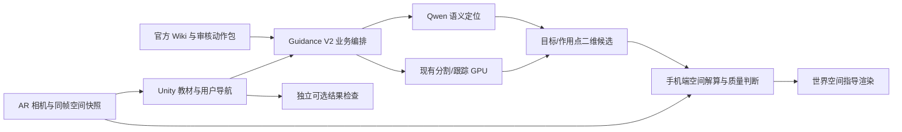

# 模块二 V2 开发手册：A1 mini 开箱的空间化操作指导

文档版本：1.0（开发规格）；编写与资料核验日期：2026-11-02。工作目录：`Manual2AR-Integrated`，当前分支：`lixin/integration-v1`，本地 main 基线：`f48cdd3`。

**本文件是开发与验收规格，不表示 V2 已完成。** 按后续用户指示，已经实施 U6/U7 的 Windows 摄像头支线：有标记定位、双视图设置、方向示意、工具参照、播放交互及多作用点。实现位置、实机视频审计和未完成项见 [当前进展](MODULE_TWO_SPATIAL_PROGRESS.md)。下文的 iOS、自动语义定位、分割部件替身等未实施内容仍属规格；验收数值不是论文或模型提供的性能保证。Windows 支线不以具备 Mac 为前提，也不替代移动 AR 验收。

当前 Windows 整合原型的交付范围与接口见 [开箱原型说明](MODULE_TWO_UNBOXING_PROTOTYPE.md)。原生 iOS、自动三维放置及完整部件动画仍未验收。

## 1. 产品目标与交付边界

实施记录更新（2026-11-03）：Windows 支线已具备 U4—U7 的 10 个动作数据与初版位置表现，见 [开箱扩展](UNBOXING_SPATIAL_EXTENSION.md)。数据覆盖与模拟运行不等于实物精度、完整部件动画或移动 AR 已验收。

保留官方章节、分步骤、图文及来源。在关键操作开始前，让用户在真实 A1 mini 上看到目标部件、作用点、工具和动作示意；移动手机时提示保持空间对应。用户自主执行、切换和结束教程，按需请求检查。

V2 的核心交互是“找到位置 → 看懂动作 → 自己操作 → 自主继续”，而非增加强制拍照关卡。空间定位成功、动画播完、用户标记已操作、可见末态检查通过是四种不同事件，不能互相代替。

### 1.1 V2.0 必须交付

- 单机/外挂料盘开箱 13 个官方章节全部保留，原图和来源可追溯，任意章节可浏览。
- 首轮精细 AR 覆盖 U4、U5、U6、U7，至少完成第 5 节定义的 10 个指导单元；多颗螺丝支持逐个聚焦。其余章节采用适合其内容的官方图文、定位或情境提示，必须明确呈现能力。
- iPhone/iPad 真机上的空间指导，至少在一台明确记录型号和 OS 的设备验收。Windows 摄像头与静态图片用于开发回归，不能替代移动 AR 验收。
- 首版允许使用固定参考标记板/经审核的空间标定。演示与报告必须标注“有标记定位”，不得称为无标记自动理解。
- 复用现有 Qwen 结构化视觉适配器、SAM3.1 首帧分割与 Cutie 跟踪；空间渲染不依赖每帧云端响应。
- 指导定位与可选末态核验使用不同请求、Prompt、状态和日志。用户不调用核验也能浏览下一步。
- 保留 AMS lite 开箱入口和官方教材；**AMS lite 精细 AR 不属于 V2.0 承诺**，在界面明确其为图文指导。其动作清单在第 5.4 节列为后续扩展，不能混入单机执行路径。
- 模块一、模块三、现有首次打印/外挂料盘进退料任务保持可运行；退出模块释放相机及 GPU 会话。

### 1.2 不作为首版承诺

不做自动驱动打印机、自动推进、螺丝扭矩判断、机械碰撞保证、任意设备自动适配、从单张图恢复精密 CAD、任意运动部件的持续 6DoF 跟踪。未测量的距离不显示为毫米级指令；设备初始化不使用编造的倒计时或成功判断。

### 1.3 两道交付门

- **V2-core 技术样机**：U6 和 U7 的完整 AR 操作链路先在真机打通，用来评审交互与空间精度，不能宣称全开箱 V2 完成。
- **V2.0 版本验收**：13 章保留、10 个指定指导单元完成、全部适用的失败处理与实物验收通过。未覆盖章节和图文降级必须在交付范围表中列出。

## 2. 参考依据与技术事实

### 2.1 论文思想与本项目的区别

《Guided Reality》是 UIST 2025 工作，而不是按当前日期计算的两年前工作。论文第 3、5 节提出五类指导：高亮、移动示意、手势、工具示意、情境控件。第 5.1 节强调保存请求时的深度与相机位姿。移动示意可以来自分割图片在空间平面上的动画，不要求完整重建机器。

本项目用已审核的官方 Wiki 确定步骤与方向，不让 LLM 自由重写开箱流程。LLM 辅助现场目标识别和解释，空间锚点及动作参数须有可验证的几何来源。论文的按步请求与人工导航不等于自动动作验收。[作者项目页](https://ryosuzuki.org/guided-reality/)，本地原文：`../Guided Reality.pdf`，重点阅读第 4–8、12、14–15 页。

### 2.2 2026 年可利用的能力及采用决定

| 能力 | 本轮核实的能力 | V2 决定 |
|---|---|---|
| SAM 3 / SAM 3.1 | 官方已有文本/视觉提示的分割跟踪及多对象版本 | 先复用仓库已固定的 SAM3.1＋Cutie，不在 AR 接入同时更换模型；新跟踪器独立对照后才替换 |
| Cutie | 可持续传播已有实例的像素掩码 | 用于轮廓更新，不把其输出当成公制三维位姿 |
| Apple 新物体跟踪 | 官方出现 `.referenceobject` 与 `trackingObjects` 的 iOS 路线 | 官方接口元数据的最低版本为 iOS/iPadOS 27.0；当前 Unity 2022.3/AR Foundation 5.1 未验证桥接。列为无标记增强实验，不作为首版默认 |
| ARKit / AR Foundation | 相机、世界跟踪、参考图像和可用时的深度 | 首版空间层主线。API 存在不代表精细部件定位可靠，必须实机量误差 |
| FoundationPose | 由 CAD 或参考数据支持的 6DoF 估计/跟踪 | 有 RGB-D、模型及计算环境时做支线实验；不解决整台打印机的关节建模，也不作为首版依赖 |
| SAM 3D Objects | 从图像推断三维对象形状/外观 | 只能作为资产/研究候选，未标定的结果不能充当螺丝、插槽的公制坐标 |

依据：[SAM 3](https://github.com/facebookresearch/sam3)、[Cutie](https://github.com/hkchengrex/Cutie)、[Apple iOS 参考对象](https://developer.apple.com/documentation/visionos/using-a-reference-object-with-arkit-in-ios)、[trackingObjects](https://developer.apple.com/documentation/arkit/arworldtrackingconfiguration/trackingobjects)、[FoundationPose](https://github.com/NVlabs/FoundationPose)、[SAM 3D Objects](https://github.com/facebookresearch/sam-3d-objects)。这些是能力核查，尚未在本项目执行模型性能对照。

**技术判断：先确定空间基准，再让视觉模型提供语义与可见轮廓。模型更新不能消除相机标定、机械结构变化、遮挡、时序和坐标转换问题。**

## 3. 当前代码能够复用什么

| 现有位置 | 当前职责 | V2 接入要求 |
|---|---|---|
| `resources/tasks/bambu_a1_mini/unboxing/v2/` | 官方开箱章节、参考图、证据、末态 Prompt | 作为不可变迁移来源；另建动作包，不直接改动旧包哈希 |
| `modules/guidance/tutorial.py` | 自由浏览、教学分步骤、章级末态建议 | 保留浏览语义；新增动作指导执行器，不把 Substep 强制变成验收关卡 |
| `modules/guidance/engine.py` | 观察点核验、人工确认、记录 | 保留旧接口；V2 检查通过独立适配器复用，不承担空间定位 |
| `modules/guidance/verification.py` | 绑定状态/观察点的结果契约 | 新增 action 级检查契约，避免把章级检查误标为当前微动作结果 |
| `modules/guidance/registry.py` | 任务目录、变体、线性状态包校验 | 按 package_type 加载新动作清单；现有四类任务不变 |
| `integrations/vlm` | 文件配置的 Qwen 客户端与审计 | 复用调用与脱敏；新增定位 Prompt，禁止把核验 Prompt 用作指导生成 |
| `integrations/perception` | GPU 适配器 | 复用服务边界，不导入模块一业务代码 |
| `packages/contracts` | 帧编号、图像哈希、共享视觉契约 | 增加独立空间观测契约；不修改 V1 FrameIdentity 的字段含义 |
| `apps/inference` | SAM3.1 / Cutie 多对象会话 | 第一阶段不改协议；上层适配器绑定 action 与目标角色 |
| `modules/inspection/progress.py` | 有界任务、分阶段结果、迟到响应处理 | 参考其并发模式；共享实现须提取到 infrastructure，不能让模块二导入模块三业务 |
| Unity `Scripts/Guidance` | 图文、拍照、分步骤按钮 | 保留内容层；将相机与空间呈现通过接口分离 |
| Unity `Scripts/Common` | 导航、主题与图标 | 继续统一；新增 AR 状态不散落在各页 |
| `deploy/colab`、`tools/colab`、`docs/COLAB_VSCODE.md` | 已有 Notebook/CLI 的 GPU 连接准备 | 按当前入口复用，不另造 V2 GPU 部署栈 |

以上 `modules`、`integrations` 路径均相对于 `apps/backend/src/manual2ar/`。当前 Unity 的 Packages 尚无 AR Foundation/ARKit 依赖，已有高亮是图像空间显示；必须新增移动 AR 相机与渲染层。

## 4. 首次实施前的设备与版本检查（P0）

本手册不假定当前已有 Mac、指定 iPhone、LiDAR、CAD 或精密标定数据。

| 必查项 | 操作 | 交付证据 | 不具备时的处理 |
|---|---|---|---|
| 真机 | 记录型号、OS、是否支持目标 AR 会话、深度来源 | capability-report.json | 可做桌面开发，不通过 AR 交付门 |
| 构建 | 确认可用 Mac/Xcode、签名、安装方式与 Unity iOS Build Support | 真机启动视频、版本清单 | 不把 Windows Editor 录像当作 iPhone 验收 |
| Unity | 以现有 2022.3.34f1 为起点，试装同代 AR Foundation/ARKit 5.1.6 并锁定依赖 | 可重复的测试构建 | 与实际 Xcode/OS 不兼容时单独升级分支，先回归四场景 |
| 现场对象 | A1 mini 单机版本、运输固定件/配件是否仍在 | 本机状态及变体清单 | 已开箱机器不能证明首次拆除流程；用合适的无动力样件验证表现并标明 |
| 原文 | 固定 Wiki 快照与软件版本 | 资源清单、哈希 | 官方更新另建版本，不静默替换 |
| 网络 | iPhone 能访问业务后端，业务后端能访问配置的 GPU | 延迟、断线、重连记录 | 手机不直连 VLM/GPU，不把 Key 打入 App |
| 标定 | 参考板、真实尺寸、安装方式、固定机架坐标 | calibration-profile + 现场照片 | 未标定时只允许图文/二维预览，不给精确空间工具示意 |

Unity 版本兼容参考：[Unity 2022.3 AR Foundation](https://docs.unity.cn/Manual/com.unity.xr.arfoundation.html)。5.1.6 是待真机试装的工程起点，不是对任意新 Xcode 的兼容承诺。

## 5. 官方开箱到指导单元的映射

### 5.1 来源与固定规则

- 官方页面：<https://wiki.bambulab.com/zh/a1-mini/manual/unboxing-a1-mini-combo>。
- 离线快照：`20261024T145623Z_e2655a`；完整 archive 的 SHA256 在 `resources/sources/bambu_wiki/manifest.json`。
- 每个指导单元必须关联原文 citation_id、相关参考图哈希、适用变体和人工审核记录。
- 单机与 AMS 的 U9 以后编号不同。业务身份使用 `task_id + variant_id + action_id`；不能只用 U9 查找动作。
- 保留官方章节标题；为了指导而拆开的动作应标记 `editorial_decomposition=true`，不冒充官方新增步骤。
- 配件、泡沫与保护膜版本遵循原文差异。不得把最新包装未附色卡判为缺件；不得要求所有屏幕保护膜都撕掉。

### 5.2 单机 13 章完整覆盖表

D1=定位高亮；D2=部件移动；D3=手势；D4=工具；D5=情境控件。组合须突出一个主指导，不把所有效果叠在一起。

| 章节 | 进一步划分的指导内容 | 表现与空间依赖 | 检查边界 / 首版范围 |
|---|---|---|---|
| U1 重要提醒 | 阅读润滑、包装及版本提醒 | 官方图文；需要润滑操作时链接独立官方指南 | 不凭本页臆造润滑动作，用户确认 |
| U2 拆箱取出 | 取顶部纸壳；按指定握持区域取设备 | D1/D3 候选；纸箱与机架不是同一锚点 | 不在裸露导轨/X轴上示意提拉；首版图文 |
| U3 配件清点 | 按单机清单分组展示 | 图文＋可选 D1 实例定位 | 可见才识别，未入镜不是缺件；首版图文/可选定位 |
| U4 解锁限制器和工具头 | 拆限制器螺丝；去扎带；稍移工具头；去泡棉 | D4、D4、D2、D1/D3；区分机架与工具头坐标 | 必做精细 AR；看不到的泡棉不宣布已去除 |
| U5 锁紧热床螺丝 | 定位底部三处；工具对准逐个提示 | D1＋D4；热床位置变化需重定位 | 必做精细 AR；不能从图像证明扭矩 |
| U6 安装吐料组件 | 找插槽并滑入；用 M3-12 固定；看安装关系 | D2、D4、D1；插槽为固定基准 | 必做精细 AR；不以单帧声称运动全程无碰撞 |
| U7 安装料盘支架 | 两颗 M3-8 固定底座；支架自上向下滑入 | D4、D2；分别定位底座和待装支架 | 必做精细 AR；不能照搬 main 的旧方向描述 |
| U8 保护膜 | 区分摄像头膜与屏幕膜层数，再按原文处理 | D1/D3 候选，官方图示始终可用 | 首版图文，保留最后一层的官方建议 |
| U9 集线器 | 按单机官方图处理线/管与固定位置 | D1、关系线/局部插入 D2 候选 | 原文未给出的单机路径不从 AMS 四管配置复制；首版图文 |
| U10 通电 | 运输物复核；空间检查；接电；开关定位 | 检查卡＋开关 D1 候选 | 电气、内部状态由用户确认；首版图文 |
| U11 打印板与初始化 | 放置打印板；设备提示下初始化/校准 | D2 候选＋D5 状态卡 | 不捏造校准时长，不解析成已通过；首版图文 |
| U12 外挂料盘附录 | 外挂料盘与 PTFE 连接的官方示意 | 图文＋可选关联现有进料任务 | 不在本版重新实现进料任务 |
| U13 废料盒 | 在吐料组件下方准备合适容器 | D1/D2 候选 | 未提供尺寸时不编造目标坐标；首版图文 |

### 5.3 V2.0 的 10 个指定空间指导单元

| action_id（省略共同前缀 `unbox.standalone.`） | 官方来源 ordinal / citation_id | 目标与动作 | 指导类型 |
|---|---|---|---|
| `zlock.remove_fasteners` | 28 / `47ada685e0d504166d9eca03` | 四颗限制器螺丝；逐个选择作用点 | D4 |
| `toolhead.remove_tie` | 29 / `c97adbf0e1837339be5c56f6` | 工具头周围运输扎带；突出扎带，工具只作示意 | D4 |
| `toolhead.slide_for_foam` | 30 / `4de210d91fa38f39a2fd07fe` | 工具头按原文稍向左移 | D2 |
| `packing.remove_foam` | 30–31 / 上项及 `18aaff3a3224135f9d359b07` | 指出显露泡棉及其他适用泡棉，移除示意 | D1/D3 |
| `bed.tighten_fasteners` | 33–34 / `661ff0e405da259e12e68b65`、`a835b0d73f70ea468d7d5bed` | 底部三颗螺丝；逐个聚焦 | D4 |
| `purge.slide_into_slot` | 36 / `83b9bd74d33eb2f7f3d387a5` | 吐料组件从后往前滑入插槽 | D2 |
| `purge.fasten` | 同 36 | 一颗 M3-12 螺丝，正确作用点 | D4 |
| `purge.inspect_alignment` | 37 / `7fee805b27b47c25d253fa93` | 示意组件与热床左边沿的安装关系 | D1；不模拟碰撞判定 |
| `holder.fasten_base` | 39 / `026a3a3c147bd8b28d5bf414` | 两颗 M3-8 固定支架底座 | D4 |
| `holder.slide_down` | 41 / `97eeffdb901ac2699a6a9aeb` | 支架从上向下滑入匹配插槽 | D2 |

“一个指导单元”可包含同类作用点集合，例如四颗螺丝；每个作用点有稳定 target_instance_id，并能逐个聚焦。切换作用点不产生视觉验收通过记录。机械方向由官方图文和实物审核确定；旋向必须注明从哪个端面观察。

### 5.4 AMS 扩展映射

AMS 变体的 U1–U8 与单机共享适用内容；U7 可选，不强制安装外挂支架。U9 的五个官方分步骤分别拆为主体放置 D2、四螺丝固定 D4、转轴颜色/形状匹配 D1＋D2、AMS 相对打印机放置 D2、四根 PTFE 管连接 D1＋路径示意。U10 为集线器，U11 为通电，U12 为打印板与初始化，U13 为废料盒。

580 mm 与 700 mm 管路及端口对应关系来自原文，不能由 VLM 从画面推断长度。管线是非刚体，整机锚点不等于每根管线的姿态。该部分先保留教材，进入后续独立 AR 验收批次。

## 6. 用户流程与界面

1. 进入模块二，选择开箱与单机/AMS 变体，先看到官方章节总览。
2. 进入任意章节；有指导单元时显示动作列表，保留原官方分步骤及参考图片。
3. 用户点“开始 AR 指导”。先建立空间基准，再拍当前视角识别本动作目标；需要调整视角时明确说明部位。
4. 先显示与该帧绑定的定位框预览；空间解算通过后才出现真实物体上的高亮、工具/移动示意。
5. 用户点“播放示意”“重播”“我已操作”或直接选下一动作。动画可以暂停，不接管设备运动。
6. 用户按需点“检查当前结果”；它生成独立的末态建议，不改写“我已操作”或冻结导航。
7. 离开、切动作、切变体、重定位时取消旧请求；返回时读取教程访问记录，重新建立空间定位，不恢复旧 world transform。

AR 指导页：摄像头背景全屏；顶部显示“章节/动作”及返回；底部一行短指令与播放、重定位、参考图、可选检查。官方图文置于可收起面板。用户界面不显示模型名、原始 JSON、掩码门限或世界坐标。用“定位中/可播放/请换角度/位置已变化”说明状态，不用持续跳动的调试文字。

参考图与空间提示都可查看，不以加载 AR 为前提阅读。自动特效不遮住真实工具接触点，手势模型可调透明度和隐藏。

## 7. 系统与职责



- 业务后端决定当前合法动作、来源、语义目标与请求生命周期。
- 视觉提供方输出图像证据，不生成未经标定的世界坐标。
- 手机掌握本次 AR session 的世界坐标、相机位姿、内参与深度；默认不上传完整深度图。
- 手机渲染循环持续运行。相机运动由本地 AR 位姿更新处理，不等待云端逐帧定位。
- 同一个打印机不是单一刚体：基座、工具头、热床、待安装配件有各自的参考框架。仅静止机架的几何点可直接绑定 device_base。
- 模块一、三的视觉算法通过中立适配器复用，禁止直接导入其 Controller 或业务服务。

## 8. 空间定位方案与选择门

### 8.1 首版：有标定的参考基准

使用固定在非运动机架/刚性夹具上的已知尺寸参考图板，通过 ARTrackedImageManager 定位参考板，再用审核后的 `T_device_from_marker` 建立打印机基准。参考板不覆盖操作部件，不阻碍运动；标记板与打印机的相对位置必须可重复固定。

参考板贴在桌面而打印机可独立移动时，不能当作机架锚点。参考图识别不可靠时，可另评估 ArUco/PnP，但它是独立定位提供方，不能假定 Unity ARKit 会直接识别任意 ArUco。[Unity 图像跟踪](https://docs.unity3d.com/Packages/com.unity.xr.arfoundation@5.1/manual/features/image-tracking.html)、[OpenCV ArUco](https://docs.opencv.org/4.x/d5/dae/tutorial_aruco_detection.html)。

离线用实物测量、多个已知点或经过验证的 CAD 建立局部作用点。每份 profile 记录设备型号、参考板物理尺寸、安装照片、测量人、日期、长度单位和标定误差。图文可先完成，空间 profile 不允许填“示意性坐标”后冒充可用。

对热床、工具头等运动部件：当前姿态与 profile 不匹配时，要求局部重定位或进入二维/图文模式。可以用可见局部特征及有效深度建立 part-local frame；其质量标准与基座锚点独立。若没有可靠 part pose，就不把固定基座坐标上的工具模型画到已经移动的螺丝上。

### 8.2 现场深度辅助：不依赖预建完整 CAD

VLM 给出目标和作用点；在同帧掩码内选择有效深度邻域，排除边界、空洞和背景，估计接触平面/局部法向。需要足够有效点和几何一致性，不能仅用框中心深度。空间信息不足时让用户调整角度或人工选择目标，再重算。

LiDAR/深度可降低几何获取成本，但反光、小螺丝、窄边缘不能仅凭深度 API 存在就认定可定位。没有深度时，已标定的机架/profile 路线仍可工作；任意平面射线命中桌面不是命中了打印机部件。[Apple sceneDepth](https://developer.apple.com/documentation/arkit/arframe/scenedepth)。

### 8.3 无标记增强：独立实验，满足条件再升级

- Apple reference-object 路线：先确认模型训练流程、iOS 版本、Unity 原生桥接、定位精度、移出视野及重新出现行为。SDK 新接口不能直接假设 AR Foundation 5.1 已暴露。
- RGB-D＋FoundationPose：先用可获得的几何模型对单个刚体做基准，验证单位、模型原点与重定位。代码、权重和资产分别记录许可。不能把整机姿态直接推广到所有可运动部件。
- 学习式重建/单目深度只用于候选几何时，必须有公制尺度和接触点精度验证。

用与首版相同测试集对照标记方案。只有达到第 15 节精度/恢复指标后，才可把其配置为默认；否则保持增强实验身份。无标记并非 V2.0 的隐含交付承诺。

## 9. 数据契约：教材、动作、现场观测、呈现分离

### 9.1 资源版本

现有路径中的 `unboxing/v2` 是旧教学包版本，不代表本手册的软件 V2。拟新增 `resources/tasks/bambu_a1_mini/unboxing/v3/`，保留原 procedure、引用与新 `guidance.json`、`targets.json`、`assets.json`、`coverage.json`。资源 catalog 与 package_type 显式指向新包，旧包仍可加载。

继续使用 task_id/variant_id 和官方章 ID；action_id 跨章节编号调整保持语义稳定。所有内容以 `plan_revision`（规范化动作数据、引用、资产描述的摘要）版本化；文件更新后旧会话不静默继承。

### 9.2 指导单元的最小结构

以下为拟定的完整示例，字段值不是实物标定结果；实际坐标由单独 calibration profile 提供。

```json
{
  "schema_version": "manual2ar-guidance-action-v2",
  "action_id": "unbox.standalone.purge.slide_into_slot",
  "variant_id": "standalone_unboxing",
  "chapter_id": "U6",
  "official_substep_id": null,
  "editorial_decomposition": true,
  "instruction": "将吐料组件从后往前滑入 X 轴末端端盖的插槽。",
  "source": {
    "snapshot_id": "20261024T145623Z_e2655a",
    "citation_ids": ["83b9bd74d33eb2f7f3d387a5"],
    "reference_images": ["references/df44ab9efd621e45.png"]
  },
  "guidance": {
    "primary_type": "movement",
    "target_id": "purge_assembly",
    "contact_target_id": "x_axis_endcap_slot",
    "reference_frame": "device_base",
    "motion": {
      "kind": "translation",
      "direction_semantics": "device_rear_to_front",
      "trajectory_source": "reviewed_calibration_profile",
      "distance_mode": "illustrative_not_measured"
    },
    "required_geometry": ["slot_entry", "insertion_axis"],
    "allowed_placements": ["calibrated_profile", "validated_depth"],
    "fallback": "official_reference"
  },
  "interaction": {"navigation": "free", "auto_advance": false},
  "verification": {"role": "advisory", "scope": "visible_final_outcome", "required": false}
}
```

新增契约还须支持：作用点集合、工具 asset_id、工具接触 socket、部件局部框架、旋转轴与观察方向、参考图哈希、适用机械状态、审核状态/审核人。状态为 draft 或几何缺失时，只呈现官方图文，不渲染精确动作。

不要沿用论文 `key_components` 的位置数组承载所有语义；采用具名字段，避免工具名称、旋向和目标混淆。`ObservationNode` 保持“检查条件”的含义，不能用同一字段同时代表教学动作和验收动作。

### 9.3 现场捕获与身份

每次动作定位包含 `run_id, variant_id, chapter_id, action_id, plan_revision, request_id, client_frame_id, source_sha256, action_epoch, ar_session_id, anchor_revision`。异步结果必须完整回传这些绑定身份。

手机端以同一 frame_token 保存：原始 RGB 尺寸/方向、送出 JPEG 的哈希、RGB→提交图像的几何变换、相机内参及其原始分辨率、同帧位姿、相机时间戳、显示变换、可用时的深度/置信度/配准、追踪状态。保存到有界缓存，过期不补用“最新帧”的 pose。

优先使用 AR 相机事件取帧并记录关联时间。若 Unity 提供方无法可靠对应 RGB、pose、depth，需要补原生 ARFrame 采集桥接或拒绝深度放置；不得把读取 Transform 的时间默认视为图像曝光时间。拟设关联偏差门槛 20 ms，P0 录制实测后冻结。网络返回再慢，只要原始包仍有效且锚点未失效，可用原包解算；是否显示旧目标还要经过动作/物体状态检查。

### 9.4 视觉回复

返回目标列表，每项包含 `target_id/instance_id/role`、found/confidence、提交图像坐标中的框、可见作用点、可选掩码引用、可见证据、遮挡/歧义及失败原因。`role` 区分待移动部件、目的区域、工具接触点；框不是接触点，也不推导旋转轴。

二维框统一 top-left XYXY、0..1000。论文/候选代码可能使用 YXYX 或 pixel XYWH，必须在适配器边界转换并测试。VLM 不返回“已成功定位”的 world XYZ 或无依据的毫米数。

### 9.5 空间结果与指导质量

`SpatialPlacement` 在手机生成：绑定 capture/anchor 身份、所属局部框架、位置/姿态、估计误差、方法、有效期、需要重新定位的条件。允许状态为 unavailable，不用零向量占位。

三类置信度分开：语义识别置信度、分割质量、空间几何误差。只有最后一项通过精度门槛才允许接触式工具示意；0.95 的 VLM confidence 不代表 5 mm 的定位误差。

## 10. 坐标与时序实施规范

约定 `T_A_from_B` 将 B 系坐标映射到 A 系，单位米，右侧列向量。序列化矩阵明确 row-major 16 元素；Unity 接收时通过一个转换模块重建，不能到处手写转置。

提交图像中的点先用保存的 RGB→提交图像变换的逆变换回到原始相机像素，再用原始内参：

```text
p_camera = depth * inverse(K_rgb) * [u_rgb, v_rgb, 1]^T
p_world  = T_world_from_camera(capture_time) * p_camera
p_world_authored = T_world_from_device * T_device_from_part * p_part
```

以上是几何表达，不是允许直接把任意供应商 pose 矩阵代入的实现代码。OpenCV 光学坐标、ARKit 相机坐标、Unity 左手坐标、图像原点和屏幕方向须通过有测试的边界转换。深度图与 RGB 分辨率/视场不同，须按提供方配准映射；不直接用同一个像素索引。

旋转轴、插入方向以审核后的 device/part frame 定义，不能依赖“当前屏幕向左”。动画轨迹是说明，独立于真实部件状态估计；播放到终点不能反过来更新真实部件的跟踪位置。

设备移动、重启 AR session、追踪中断、标记重新定位跳变、工具头/热床移动后，递增相应 epoch/revision。立即隐藏依赖失效框架的提示，只保留其他可信提示或图文。错误锚点不能用平滑插值掩盖。

## 11. 后端接口与并发

在现有 `/api/guidance` 下新增 `/v2` 路由组，旧 API 不变；不是替换所有模块的 API 版本。建议端点：

| 方法与路径（拟定） | 职责 |
|---|---|
| `GET /api/guidance/v2/tasks/{task_id}/variants/{variant_id}/plan` | 返回审核过的动作清单、来源和资产目录 |
| `POST /api/guidance/v2/runs` | 创建开箱动作会话，返回 plan_revision |
| `POST /api/guidance/v2/runs/{run_id}/selection` | 选择章节/动作，递增 action_epoch，取消旧任务 |
| `POST /api/guidance/v2/runs/{run_id}/guidance-jobs` | 提交当前捕获与动作，202 返回 job_id |
| `GET /api/guidance/v2/runs/{run_id}/guidance-jobs/{job_id}?after_revision=N` | 有序增量状态及定位/掩码结果 |
| `DELETE /api/guidance/v2/runs/{run_id}/guidance-jobs/{job_id}` | 幂等取消，迟到资源关闭 |
| `POST /api/guidance/v2/runs/{run_id}/checks` | 可选末态检查，与指导 job 分离 |
| `POST /api/guidance/v2/runs/{run_id}/events` | 播放、用户标记、空间结果及显示回执 |
| `DELETE /api/guidance/v2/runs/{run_id}` | 结束会话、关闭跟踪和取消所有 pending job |

关键阶段：accepted → locating → candidate_ready → optional_segmenting → visual_ready。手机再产生 spatial_ready / needs_alignment / rendered；后端不能未收到手机证据就宣称空间就绪。

定位框可先用于明确标记的二维预览。动作的 3D 方向、接触点和动画要等 spatial_ready，不能因为框先到就提前使用猜测的平面。

每个 run 最多一个活动指导初始化；新动作取消旧动作。队列仅保留最新待处理捕获，不积压视频帧。建议默认 VLM 定位超时 60 s、初始分割沿用当前 GPU 超时上限，具体值在 P0 网络实测后冻结；界面全过程可退出。重试只对网络和格式失败有界执行，不无限调用付费模型。

GPU 默认 maximum_sessions=1 是整个工作进程的容量，而不是每个模块各一个。切模块必须关闭原会话；不能以扩容参数掩盖会话泄漏。现有 Colab/HPC 连接文件与权限机制复用，手机只访问业务后端。

## 12. Prompt 与资产

### 12.1 定位 Prompt

输入：审核动作指令、目标描述/实例选择条件、作用点角色、官方允许方向、当前图片。可以附经批准的官方参考图帮助识别，必须给图片标注“现场/参考”角色；参考图不能代替现场存在证据。

输出限定为第 9.4 节契约。看不到/被挡住/多个相似部件时返回不确定及具体换角度提示；不得把最近的可见螺丝当作指定螺丝。工具/方向方案来自审核动作包，不让模型任意换操作。

### 12.2 可选检查 Prompt

以 action_id 或明确标记的 chapter_id 为 scope；只问可见末态。章节检查不自动转成当前微动作结论。用户主动触发；视觉结果不篡改人工标记，也不要求用户复演操作。

### 12.3 资产最小库

首版资产：可调透明的高亮、直线/曲线箭头、分割图片 ghost、一个经确认的内六角工具、剪刀示意、少量抓取/移除手势、情境状态卡。基础图形尽量使用代码网格；工具和手势采用审定模型，缺失时使用官方图文，不现场生成未经确认的工具模型。

每个模型需记录 origin、米制尺度、功能端 contact_socket、局部轴、可用动画/旋向、许可、来源、哈希、修改说明。先在坐标测试场景中验证接触端对齐，再进入实物。模型看起来像工具不代表其工具头在正确位置。

工具幽灵模型与真实部件之间使用偏移避免遮挡，但引线必须指向真实作用点。没有可靠深度遮挡时使用明确的示意线框，不声称正确处理了真实遮挡。语音是可选辅助，不是 V2.0 阻塞项；不要求复制第三方英语录音。

## 13. 具体代码改造清单（拟定）

| 部位 | 新增/调整 | 完成定义 |
|---|---|---|
| 后端 `modules/guidance/action_models.py` | 动作、来源、目标、检查 scope | JSON Schema 与迁移测试 |
| `modules/guidance/action_package.py` | 加载新动作包、校验引用与哈希 | 无来源/错误 variant/缺失资产可定位报错 |
| `modules/guidance/action_service.py` | 选择、独立进度、用户标记 | 浏览/人工/视觉/空间状态分离 |
| `modules/guidance/localization.py` | 目标定位与二维作用点 | 语义角色、歧义、Prompt、模型结果留证 |
| `modules/guidance/guidance_jobs.py` | 分阶段有界异步任务 | 取消、重试、超时、迟到回复、会话释放测试 |
| `modules/guidance/v2_server.py` | 第 11 节路由 | 显式挂到 application.server，不影响旧路由 |
| `packages/contracts/.../spatial.py` | 图像变换、frame_token、几何结果 | Python/C# 共用示例和坐标金标准 |
| Unity `Scripts/Guidance/V2` | 动作导航、AR 状态和 UI | 不复制模块一/三 Controller |
| Unity `Scripts/Spatial` | 相机适配、同帧快照、参考板/深度提供方、锚点管理 | 所有坐标变换集中管理 |
| Unity `GuidanceRenderer` | D1–D5 与资产适配 | 输入已批准的 placement；不自行猜几何 |
| Unity Packages/场景 | AR Foundation、ARKit、XR Origin、AR Session、相机、参考库 | 桌面/移动模式明确，一次只运行一种相机来源 |
| 工具 `tools/resources/compile_unboxing_guidance.py` | 原文到动作包的可审核编译 | 编译计划可 diff，不用 LLM 无约束覆盖原文 |
| 工具 `tools/evaluation/guidance_static.py` | 静态语义、框点、分割与计划校验 | 输入目录与输出目录分离，标明没有 AR 通过结论 |
| 工具 `tools/evaluation/guidance_replay.py` | 已记录同帧包回放与空间变换验证 | 可注入延迟、旋转、镜像、丢帧与追踪失效 |

当前 `tools.evaluation.static_test --module` 只接受 learning/inspection；不能把拟定的 guidance 命令当作已存在功能。当前四场景可在模块二内部加入 AR 子模式；新增场景时显式更新导航与构建清单测试。

注册器当前要求线性 states，且 TutorialTaskPackage 强制每章一个观察点。V2 继续保留该章级文档作为教材，不把动作图硬塞进 observation_nodes；新 action package 的顺序/分组独立验证。Browse/Command 现有正则只支持章和原子步骤 ID，新接口显式定义 action_id，不能直接突破旧 DTO。

## 14. 配置、日志与诊断

新增参数放在现有 `configs/app.local.json` 的模块二设置下，公开白名单只导出客户端必要值。实施时同步修改配置校验和模块 settings allowlist；只向文件添加字段而不更新校验会导致启动失败。

建议字段：guidance_v2.enabled、capture_mode、placement_provider、calibration_profile、target_error_limits、depth_sync_limit_ms、max_capture_cache、overlay_expiry、model_timeout、asset_pack_revision、recording_policy。字段最终命名通过契约评审冻结。标定 profile 不含 Key，私有设备标识和现场记录仍放项目外。

每次会话在 `paths.runtime/guidance_v2/<run_id>/` 保存：

```text
session.json             软件/资源/资产/标定/模型版本，不含凭据
plan.json                本次动作清单及官方引用
captures/<frame_token>/  获准保留的原图、几何快照、变换和深度元数据
jobs/<job_id>/           Prompt、脱敏回复、候选框点、掩码及时间记录
placements/              定位方法、误差、拒绝原因、锚点修订
checks/                  用户主动请求的末态建议
ui-events.jsonl          实际播放/隐藏/取消/用户标记/显示回执
summary.json             耗时、错误分类、空间误差与覆盖情况
```

默认不无界录制视频/深度。现场采集策略在配置文件中选择，UI 显示记录状态。凭据、Authorization、供应商错误原文不进入日志。所有阶段使用关联身份；保留 capture_time/server_receive/model_done/client_apply，单机耗时用单调时钟，跨机不直接相减假设同步。

错误分类至少区分 semantic_target_error、contact_point_error、segmentation_error、depth_invalid、frame_transform_error、pose_stale、anchor_lost、part_moved、asset_socket_error、render_error、network_timeout。必须能从 summary 回溯原始输入；不要统一显示成“AI失败”。

## 15. 验收指标与测试方案

### 15.1 所有阶段的否决项

错误 variant、错误部件、过期帧或失效锚点仍显示精确提示；把桌面二维预览称为 AR 完成；把用户点击/动画结束改成视觉通过；把章级检查误报为当前子动作通过。出现任一项，版本不通过。

### 15.2 提出的 V2.0 工程门槛

| 指标 | 门槛与测法 |
|---|---|
| 原文与资产 | 13 章保留，10 个指定单元均可回溯原文/参考图；无审核方向不能精确渲染 |
| 目标身份 | 对锁定测试集至少 95% 正确；错误与不确定分开统计，不确定不能算成功 |
| 空间粗定位 | 实物已知点误差 P95 ≤15 mm；覆盖不同视角，而非仅屏幕像素误差 |
| 螺丝/工具接触点 | P95 ≤5 mm，且不超过最近相似目标间距的一半；达不到时不允许贴合式工具表现，只显示定位引线/官方图 |
| 旋向/动作方向 | 所有已发布动作经两人按官方图文审核；测例中不得出现反向演示 |
| 追踪失效 | 本地知道失效后 200 ms 内隐藏依赖该锚点的精确提示；失联未知运动必须通过新观测更新，不能声称检测到了未观测运动 |
| 渲染 | 指定真机连续 5 分钟，UI/AR 中位帧率 ≥30 fps，P95 帧时 ≤50 ms；模型结果更新率另报 |
| 模型等待 | 目标是 VLM 框返回 P95 ≤8 s；分割初始化耗时单列，不能用本地 30 fps 声称云端实时。超目标须记录并改善，不能伪造进度 |
| 交互 | 旧请求中切动作/退出在 500 ms 内恢复操作，旧回复不能覆盖新页；弱网下能继续阅读图文 |
| 模块回归 | 四场景导航、原章级检查、首次打印与进退料、模块一/三均无行为回归 |

这些值需要在 P0/P1 用可测夹具建立 ground truth。若精细接触点门槛不可达，须调整范围与展示方式并经评审，不能放宽后仍称已完成精确工具指导。固定误差下的漂亮动画不是验收证据。

### 15.3 测试分层

1. 契约/单元：来源存在、哈希、变体、动作 ID、工具 socket、单位、矩阵、镜像旋转、裁剪缩放、框格式、深度配准、取消幂等。
2. 静态：固定五类视角（正面、左右斜侧、近拍、遮挡），现场图与输出分目录。评估目标/作用点人工标注误差与掩码 IoU，不能用模型自评分当真值。
3. 回放：使用同帧包，注入 0.5/2/5 秒延迟、乱序、动作切换、AR session 重置、源分辨率变化，验证不能用新 pose 解旧 RGB。
4. 真机：至少一台明确型号设备、两名操作人、两个光照条件、近/中/侧三种取景。每个指定指导单元至少 12 次试验，失败计入分母。
5. 几何：独立的标定板/测量点与审核夹具给出真值；开发时调参数据与最终验收录制分开。
6. 手持移动：左右移动与绕到另一侧、暂时遮挡、离开后返回、移打印机/热床/工具头；检查只让有效框架继续显示。
7. 无 GPU：能显示可用的标定 AR 与官方图文；依赖分割的效果显示未就绪，不冒充 GPU 成功。

用户研究作为后续科研验收，可对比官方图文、二维高亮、V2 空间动作指导，记录找错部件次数、方向理解、求助次数与完成时间。初版小样本试验不宣称复现论文统计结论。

## 16. 分阶段开发与交付物

| 阶段 | 工作内容 | 可验收交付物 | 进入下一阶段条件 |
|---|---|---|---|
| P0 可行性与资源冻结 | 核实设备/构建/网络；确认标定路线；资源与许可盘点 | capability-report、版本锁、来源清单、授权状态 | 真机 AR 基本会话可运行；缺 Mac/真机则止于开发准备 |
| P1 空间底座 | 单标记板＋一个已知点；同帧采集、矩阵、锚点失效 | iOS 空间测试场景、几何回放、误差报告 | 手机移动时已知点不漂移，粗/精定位能力有量化结果 |
| P2 动作教材 | 编译 13 章与 10 个单元，关联原文/资产/作用点 | 新动作包、coverage、Schema、原文审查记录 | 每个单元来源、方向和适用状态明确 |
| P3 U6/U7 闭环 | 完成 D2、D4、阶段定位与用户交互 | V2-core 真机视频、录制包、错误报告 | 4 类典型交互可演示；不是录屏播放或二维冒充 |
| P4 U4/U5 与恢复 | 多作用点、工具头/热床局部基准、遮挡/失效处理 | 全部 10 单元、失败恢复与检查范围测试 | 需要精度的单元通过接触点门槛 |
| P5 版本验收 | 现场矩阵、性能、四场景回归、交付说明 | V2.0 安装/源码/资料/验收包 | 第 15 节通过；未通过项明确退回 |
| E1 无标记增强 | 新 Apple 物体跟踪或 6DoF 路线对照 | 独立能力与误差报告 | 达到相同门槛后才替换主定位提供方 |

不是按模型清单并行堆功能。一个开发者按 P0→P1→P2→P3→P4→P5 执行，先把一个空间目标和一个动作做准；多人协作时以相同契约拆为资料、后端、Unity/AR、验证四条工作项。没有现场设备就不能把 P4/P5 排为已完成。

## 17. 实验室端到端演示脚本

1. 展示官方开箱总览，选择单机，说明本次是有标记空间指导的 V2-core 或完整 V2.0，二者不得混称。
2. 进入 U6，手机对准机架建立参考；定位插槽。移动手机，展示提示仍跟随真实位置。
3. 播放吐料组件从后往前的半透明示意；用户重播后自主安装。切至 M3-12 固定动作，显示工具作用点。
4. 用户可直接继续，也可点击“检查当前结果”；展示建议与人工标记互不替代。
5. 进入 U7，展示底座两处与支架向下滑入；移动手机改变视角，方向不变成屏幕方向。
6. 遮住参考板/目标或移动机架，确认程序提示重定位并隐藏失效提示。复位后重定位，不拿旧锚点继续。
7. 展示一项仅图文/人工确认的内容，例如校准，说明未把它误报为视觉通过。
8. 返回欢迎页，模块一/三仍能进入；检查 GPU 会话释放。

样机不能反复执行真实拆箱时，用无动力样件展示拆卸指导并在视频中标注；不得用已完成安装机器的视频替代实际首次开箱验证。

## 18. 最终交付包

全部生成物位于 `paths.builds/module-two-v2/<版本>/`，源代码和教材留在规范目录。

- 源码版本与资源/资产/模型/标定哈希，依赖锁和变更清单。
- Windows 开发用 Unity 工程包；iOS Xcode 工程/适用安装方式与签名说明，不含私钥和 Key。
- 官方原文证据引用、新动作包、参考图、资产许可与第三方说明。
- 现场 calibration profile；未完成的草稿与已验收 profile 分开。
- 静态/回放输入清单及报告、实物误差、追踪恢复、延迟和性能报告。
- 3–5 分钟端到端演示、一次明确失败/重定位演示及设备型号。
- 用户快速指南：开始定位、播放示意、换角度、重定位、查看原文、可选检查、退出。
- `known-limitations.md`：允许的设备/变体、空间范围、遮挡、未覆盖章节与未实测平台。

验收报告不得只写“175 项测试通过”。旧回归证明旧软件行为，新 V2 必须增加并报告自己的契约、几何和真机结果。

## 19. 开发开始时的第一批具体工作项

- [ ] 核定真机、Mac/Xcode、网络与标定可行性，建立 capability-report。
- [ ] 确认师兄接受首轮有标记定位及单机范围，记录 V2-core/V2.0 的分界。
- [ ] 冻结动作/捕获/几何/检查四份契约和坐标金标准。
- [ ] 对 U6、U7 官方图文做动作与方向审核；测量固定插槽/底座/工具接触点。
- [ ] 先实现不调用 VLM 的已知空间点测试，验证手机移动与重定位。
- [ ] 再连接 Qwen 定位及现有 GPU，验证框、掩码和空间结果分阶段显示。
- [ ] 完成独立“指导”与“可选检查”，保留自由浏览和用户标记。
- [ ] 后续复用第三方代码前固定提交并完成第 20 节的授权与适配核查。

本轮不创建开发分支、不提交 Git、不升级 Unity、不改动现有任务规则。后续实施应先保存当前已审核的整合版，再创建 V2 功能分支；分阶段交付保持可回退。

## 20. Guided Reality 公开代码与资产复用审计

### 20.1 已找到的作者仓库与固定版本

本轮找到公开仓库 [AdaZhao1211/Guided-Reality-Unity](https://github.com/AdaZhao1211/Guided-Reality-Unity)。账号公开资料显示姓名 Ada Zhao、主页 adazhao.info、ATLAS/CU Boulder，与论文第一作者身份相符；这比仅凭同名搜索结果更可靠。固定审计提交：`478d9d7318b175c65715650ab4d45ae36433d8a0`，不是随时变化的 main。

它是 Unity 6000.3.19f1、Quest 3/3S、Meta XR SDK 85 的实验实现，使用 Gemini 和外部 SAM-2，**不是论文原始 Swift/iPad 工程，也不是现有 Unity 2022.3/iPhone 工程的即插即用模块**。README 说明原始 USDZ 不在仓库内；已存在转换后的 FBX 和英语音频。[固定版本 README](https://github.com/AdaZhao1211/Guided-Reality-Unity/blob/478d9d7318b175c65715650ab4d45ae36433d8a0/README.md)。

项目主页虽然显示 GitHub 字样，但本轮检查其 HTML 未发现该字样附实际仓库链接；直接检查 GitHub 作者账号与仓库获得了上述结果。不能据主页占位文字推断代码不存在，也不把其他同名项目当成论文实现。

### 20.2 本轮已做与未做的复用尝试

已经完成公开仓库递归文件树、固定提交、README 和 11 份小型文本文件的静态审计；记录源码哈希，确认功能和平台耦合。审阅副本位于项目外：

`/home/lixin/projects/Manual2AR-Data/sources/third-party-audits/guided-reality/`

其中 repository.json 记录 commit、GitHub license 元数据与完整文件树，reviewed-files.json 记录已读取文件的 SHA256。未下载 FBX/音频，未执行作者工具脚本，未安装 Meta XR，未把其源文件复制进 Manual2AR，未进行 Unity 编译或头显测试。这是完成的**静态可移植性验证**，不是运行复现。

### 20.3 优先参考/获授权后可提取的内容

以下文件路径相对于作者仓库；每项都应在取得相应代码/资产授权后才复制或修改分发。本轮只分析实现方式，不移入产品源码。

| 文件 | 已核实内容 | 本项目适配方式 | 优先级 |
|---|---|---|---|
| `Assets/GuidedReality/Runtime/Protocol.cs` | 捕获快照、保存的位姿/投影射线、深度样本、裁片帧身份校验 | 参考其冻结快照设计；映射为本手册 frame_token 与版本化契约，不照搬 API 字段 | 高 |
| `.../CropGeometry.cs` | 用捕获时的相机射线和裁片中心附近深度，把透明裁片投到空间平面 | 获授权后可提取纯几何计算并增加方向/裁剪/帧身份测试；保留“平面近似”标记 | 高 |
| `.../GuidanceVisual.cs` | 小目标粒子/轮廓、情境计时、工具与手势的空间呈现 | 分拆成各指导 Renderer；将硬编码尺寸改成资产 socket 与审核尺度 | 高 |
| `.../InstructionStep.cs` | 五类表现与 instruction 数据解析 | 作为导入适配器参考；最终使用具名动作字段与官方来源，不用位置字符串数组承载全部语义 | 中 |
| `.../GuidedRealityApp.cs` | 单步取景、异步定位、分割、锚点与显示组织 | 参考流程；不能复制 Gemini 客户端直连、全局 busy 或 Quest 输入到模块二 | 中 |
| `.../QuestFrameCapture.cs` | 抓取相机纹理、冻结相机射线、环境深度网格 | 只参考采集数据的结构；Meta Camera/EnvironmentRaycast API 必须由 ARKit 提供方替代 | 不直接移植 |
| `Assets/GuidedReality/Editor/GuidanceValidation.cs` | 资产、指令与几何的编辑器检查 | 为本项目生成相同类别的校验；旧检查通过不等于 iPhone 现场通过 | 高 |
| `Tools/convert_guidance_models.py` | 原始模型到 Unity 资产的转换流程 | 只有原始 USDZ 与授权都具备才采用；当前原始源缺失，不能承诺完全再生成 | 条件复用 |

几何代码来源：[CropGeometry.cs](https://github.com/AdaZhao1211/Guided-Reality-Unity/blob/478d9d7318b175c65715650ab4d45ae36433d8a0/Assets/GuidedReality/Runtime/CropGeometry.cs)。呈现代码来源：[GuidanceVisual.cs](https://github.com/AdaZhao1211/Guided-Reality-Unity/blob/478d9d7318b175c65715650ab4d45ae36433d8a0/Assets/GuidedReality/Runtime/GuidanceVisual.cs)。这些文件可缩短理解和验证时间，但当前近邻深度/图像平面近似仍须经过本手册的细部接触点精度门。

### 20.4 资产盘点与不匹配项

文件树包含 `Assets/Resources/GuidanceModels/` 下的 Screwdriver、Wrench、Scraper、Hammer 等工具，poke、hook、hold、Palm 等静态手势，以及方向箭头。可作为资产候选，但没有逐资产授权和实物尺度确认。

**当前清单未见明确的开箱内六角扳手或剪刀模型。** 不能把普通螺丝刀/Wrench 模型自动当成官方要求的工具。第一批工具优先自行制作/取得明确授权的正确模型；基础箭头可用本项目代码网格实现。英语音频针对另一任务，不复用为中文 A1 mini 开箱讲解。

### 20.5 当前许可结论

本轮固定提交的完整文件树中未发现 LICENSE/LICENCE/COPYING/NOTICE 文件，GitHub 仓库 license 元数据为 null，已审阅文本也未发现代码/模型授权说明。因此准确状态是“**公开可阅读、复用授权未确认**”，不能称为已确认开源授权。

论文的 CC BY 4.0 不自动覆盖该仓库中单独提供的源代码、FBX、手势和音频。作者明确许可或补充许可证后，分别登记代码与资产授权、归属、修改要求和允许用途。未明确之前，不把它作为 V2 必须直接导入的依赖；由本项目独立实现规范化指导与几何接口，保留文献引用。

需要向作者确认的事项：Unity 代码许可；转换 FBX 和原始模型的来源/分发范围；手势与音频许可；与论文原始 iPad 工程的对应关系；是否可提供原始 USDZ。此清单是后续联系建议，本轮没有发送邮件、提交 issue 或联系作者。

### 20.6 不应直接继承的实现假设

- Quest 的深度样本网格不是 iPhone 的原生深度图，其最近邻误差对小螺丝不能直接套用。
- 冻结捕获能改善异步放置，但不能持续跟踪已移动的部件；README 也说明捕获后运动对象不被跟踪。
- 该移植版 D2 包含蓝色裁片/可选翻转箭头，不能仅凭“五类支持”假定已具备通用起点→终点的平移轨迹契约；本轮审阅的数据流未见通用 target_pos 字段，仍需按开箱动作实现。
- Gemini Key 在客户端、SAM `/segment` 的协议和当前服务不同。Manual2AR 继续保持业务后端持有 Key，用适配器调用现有 GPU。
- Unity 6/Meta XR 工程设置与控制器导航不迁入当前 iPhone 工程；不得为了复用视觉 Renderer 全量升级所有模块。
- 工具按包围盒缩放的展示不等于实际接触端对齐，必须改成模型本地 socket/轴与经过审核的尺度。

### 20.7 获授权后的提取顺序

1. 固定上述提交，保存许可文本和逐资产清单；只选 CropGeometry/Protocol 的独立部分和 D1/D2 Renderer。
2. 在隔离的 Unity 测试场景适配到本项目 FrameSnapshot/SpatialPlacement；先用合成几何核对裁片尺寸、上下方向和保存位姿。
3. 用 iPhone ARKit 捕获提供方替换 QuestFrameCapture，用现有 Qwen/GPU 服务替换 RemoteClients。既不携带其 Key 设置，也不导入整套 Package manifest。
4. 验证 U6/U7 真机表现后，再接入工具/手势资产；逐一验证 contact_socket、朝向、尺度、遮挡和取消销毁。
5. 对每个迁入文件/资产记录原 URL、commit、SHA256、许可、改动、测试。不能只以“来自 Guided Reality”作为依赖说明。

若授权一直未明确，继续独立实现；首版交付不能以拿不到作者仓库模型为理由无限延期。高亮、轨迹、图像平面、固定参考板与手动继续的核心功能均不必依赖该资产包。

## 21. 参考资料与证据等级

- [公开 Unity 版本](https://github.com/AdaZhao1211/Guided-Reality-Unity)，许可与平台差异见第 20 节。
- 本地论文：`../Guided Reality.pdf`，UIST 2025。论文实验结果不作为本系统性能承诺。
- [作者项目页](https://ryosuzuki.org/guided-reality/)、[第一作者页面](https://adazhao.info/GuidedReality)。
- [官方开箱 Wiki](https://wiki.bambulab.com/zh/a1-mini/manual/unboxing-a1-mini-combo)。本手册具体动作依据项目固定离线快照，不声称已比较官网所有后续更新。
- [Unity AR Foundation 5.1 相机](https://docs.unity3d.com/Packages/com.unity.xr.arfoundation@5.1/manual/features/camera.html)、[图像跟踪](https://docs.unity3d.com/Packages/com.unity.xr.arfoundation@5.1/manual/features/image-tracking.html)。
- [ARKit sceneDepth](https://developer.apple.com/documentation/arkit/arframe/scenedepth)、[新物体跟踪接口](https://developer.apple.com/documentation/arkit/arworldtrackingconfiguration/trackingobjects)。后者官方 DocC 元数据标记 iOS/iPadOS 27.0，不能直接推广到旧设备/旧 Unity。
- [SAM 3](https://github.com/facebookresearch/sam3)、[Cutie](https://github.com/hkchengrex/Cutie)、[SAM 3D Objects](https://github.com/facebookresearch/sam-3d-objects)、[FoundationPose](https://github.com/NVlabs/FoundationPose)。候选模型的 README 能力与本项目实测结果严格区分。

证据等级：官方资料/论文描述 → 当前仓库代码存在 → 单元/回放可运行 → 指定设备现场验证。只有最后一级才支持真机 AR 交付声明。本手册完成前两级的审计和实施设计，尚未完成后两级的 V2 实施。
